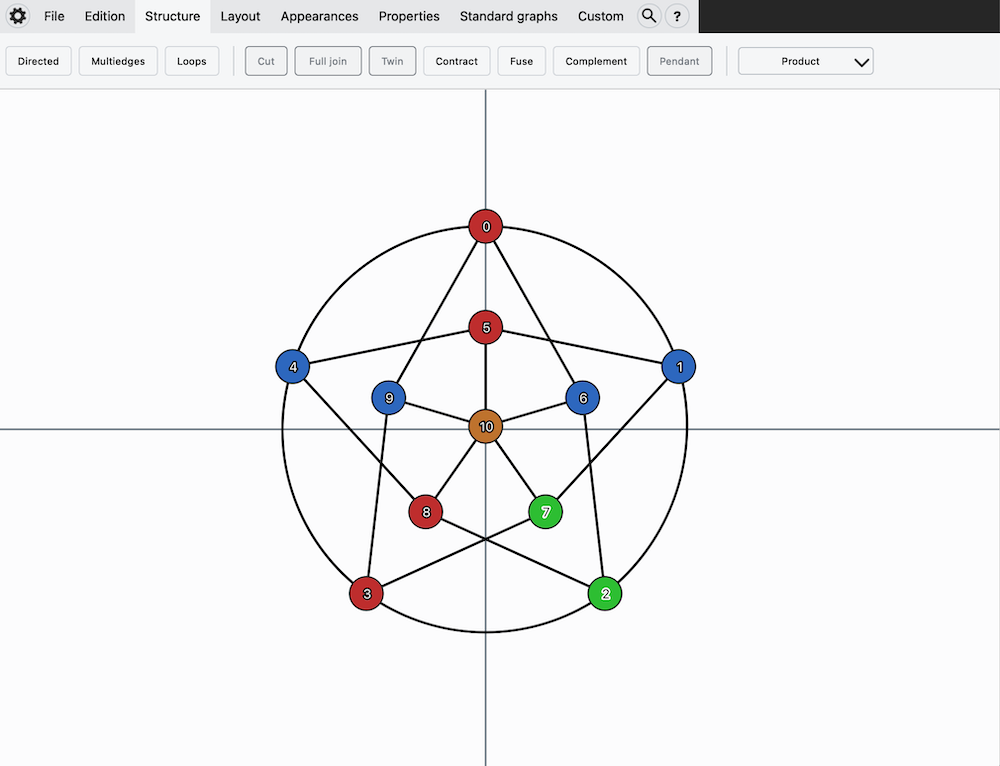

# Graph Builder

Graph Builder is a Python graph editor built with Qt and NetworkX. It edits
directed or undirected coloured graphs, supports curved edges, labels, grids,
selection, undo and redo, custom graph actions, GraphML files and TikZ export.

## First launch: download the app

Download the archive for your computer from [Releases](https://github.com/CyrilPujol/graph-builder/releases), then extract it. These downloads include Python and the editor's dependencies. You do not need a terminal or a Python installation.

- **macOS:** open `Graph Builder.app`. You can move it to Applications. There are separate Apple Silicon and Intel downloads.
- **Windows:** open the extracted `Graph Builder` folder and double-click `Graph Builder.exe`. Keep the entire folder together.
- **Linux:** extract the archive and launch the `Graph Builder` executable inside its folder. If your file manager will not launch it, run `./Graph\ Builder/Graph\ Builder` from the extracted directory.

To open a `.graphml` file by double-clicking it, choose Graph Builder as its default app once:

- **macOS:** move `Graph Builder.app` to Applications, then use a GraphML file's **Get Info → Open with → Graph Builder → Change All**. The app also accepts **Open With** and files dropped on its Dock icon, including while it is already running.
- **Windows:** right-click a GraphML file and choose **Open with → Choose another app**, browse to `Graph Builder.exe`, and choose **Always**. The app registers its GraphML document icon automatically when it starts, without administrator access or changing your default app. Keep its whole folder together. If you move it later, launch it once from the new location.
- **Linux:** launch the extracted app once to add Graph Builder to your applications list and register its GraphML icon. Then choose Graph Builder using your file manager's **Open with** option. Registration needs no administrator access and does not change your default opener. Keep the app folder together. If you move it, launch it once from the new location.



**File → Open** also imports graph6, sparse6, and digraph6 files (`.g6`, `.s6`, `.d6` and their long extensions), including loops and parallel edges where supported by the format. For files containing several graphs, choose the graph to open. Imported graphs receive an initial drawing and save as new GraphML documents, preserving the source file.

These builds are currently unsigned. Your operating system may ask you to confirm that you trust the downloaded app. On macOS, use **Open** from the app's context menu if a normal double-click is blocked. On Windows, use **More info → Run anyway** only if the publisher and download are the ones you expected. On its first launch, the app offers a skippable, action-driven tour that starts with an almost-complete M₂(C₅) graph. Later launches start with a new untitled graph. The tour can be replayed from the **?** guide. Replaying asks before replacing a nonempty graph.

The release archives are made on their own operating systems. [Build instructions](BUILDING.md) explain how to reproduce them.

## Editing

The main controls are as follows:
- Left-click a vertex or edge to select it. Left-click empty space to create a vertex. Drag a vertex to move it; drag empty space for a vertex-only rectangle selection.
- Right-drag (or Ctrl-left-drag) from a vertex to another vertex to toggle an edge. Right-clicking a vertex deletes it.
- Hold Shift during a right-drag to make a path. Each vertex you pass through immediately receives an edge from the previous vertex. On a trackpad, Ctrl+Shift-left-drag does the same.
- Right-drag empty space for a lasso selection. Option/Alt-drag or middle-drag pans.
- Hold Shift while selecting to add to the selection. Ctrl+Shift removes instead.
- Double-click a vertex or edge to open **Properties** for its label and appearance. A double-click inside a selection of the same kind edits the whole group without touching labels. **Delete** (or the Del key) removes the selection.
- Drag a selected edge to curve it.

The top bar groups the tools into menus:

- **File** Contains file actions such as saves, opens and exports as tikz or picture.
- **Edition** has undo, selection and transformations. 
- **Structure** has graph operations and controls directed edges, loops and multiedges.
- **Layout** has Fit graph, automatic placement and drawing guides. In Automatic mode, pin vertices to keep them fixed while arranging the rest.
- **Appearances** controls labels, styles, curves and regions. Edit a basic style to update every object that inherits it, or give an object its own custom look. Filled regions are ignored by structural properties.
- **Properties** computes graph measures, checks graph classes and tests subgraphs, morphisms and minors. Bounds appear immediately, use **Compute** for a deeper search and **Show** to display a solution on the graph. A search that times out is not a proof.
    Most NP-hard problems are approched via a SAT-solver. When lunching via Python, some installs can be necessary for this feature, see next section. 
- **Standard graphs** adds familiar graph families, with parameters such as size or degree.
- **Custom** contains functions added by your Python script. See the [Python guide](docs/PYTHON_LIB.md) to add your own.
The **⚙** button opens keyboard shortcuts and theme preferences. 
The **?** button shows quick controls and replays the tutorial.

**File → Save As** saves the current graph in a file. This file can later be directly open with the app. 
**File → Export to TikZ** generates `tikz` code for the graph (as `.tex`). To use in your main file use `\input{PATH_TO_GRAPH}`.
**File → Export picture** renders that TikZ as PDF, SVG, or PNG. This needs a local LaTeX installation with TikZ and `standalone`.
The fourth format, **PDF (Ipe compatible)**, adds editable Ipe data using
`pdftoipe` from ipe-tools and `ipetoipe` from Ipe. Install both tools and make
them available on PATH. 
For PNG and SVG, install Poppler's `pdftocairo` too. SVG can alternatively use
`dvisvgm` if its PDF support is available. These tools are not bundled in the
downloadable app. 

Vertex and edge labels are always interpreted as LaTeX by TikZ export. Write
`\\#` for a literal `#` and use normal LaTeX syntax for other special
characters. The editor canvas displays the source text without typesetting it.


## Use it as a Python library

Python 3.10 or newer is required. Open a terminal and use the commands below.

On macOS or Linux:

```sh
cd "/path/to/graph_builder"
python3 -m pip install --user -e .
python3 graph_builder.py
```

On Windows (PowerShell):

```powershell
cd "C:\path\to\graph_builder"
py -3 -m pip install --user -e .
py -3 graph_builder.py
```

Replace the path in the `cd` command with the location where you extracted or cloned the source. This installs Graph Builder for your normal Python user account, so scripts run with that Python can import `graph_builder` from any folder. If your Python installation refuses direct installs, use a virtual environment instead. Installing the downloadable app does not install the Python library.

The project stays in place, so editing its Python files changes the app. Add
`--graph path/to/drawing.graphml` to the launch command to open a specific file.
Running `graph_builder.py` directly starts a clean, untitled editor without personal custom buttons. It asks where to save when you first save the drawing. Calling `main()` from your own script retains the original `graph.graphml` default in that script's working directory, unless you pass `graph_file` or `untitled=True`. An unsaved graph made with **File → New** asks before closing. 

Some computations use OR-Tools as SAT-solver, which can be installed with `python3 -m pip install --user -e '.[solver]'` from the project folder.

To use the editor as one step in a Python program, call `edit_graph` instead of
`main`:

```python
import networkx as nx
from graph_builder import edit_graph

graph = edit_graph(nx.path_graph(4))  # Draw or edit, then close the window.
print(graph.number_of_edges())       # Continue with the edited graph.
```

`edit_graph()` also starts with an empty graph. It accepts an `nx.Graph` or
`nx.DiGraph`, leaves the input untouched, and returns the currently open graph
when its window closes. Returned vertex keys are integers. Input integer keys
are preserved, while other keys are assigned fresh integers and kept as
visible labels if no label was set. Vertices added in the editor also receive
integer keys. Saving a file is optional. `main()` remains the simple
launcher for a standalone editor and returns an application exit code rather
than a graph. Both calls discover `@button` functions in the calling module.

`graph_builder.py` is the stable import surface, not a place for personal changes. The implementation lives in `graph_builder_core/`. See [Custom Python functions and graph data](docs/PYTHON_LIB.md), the [basic example](examples/example_basic.py), and the [signed-graph example](examples/example_signed_graphs.py). If you keep personal scripts or drawings in this checkout, put them in `local/`, which Git ignores. Put drawings you intend to share under `examples/`.

To build a menu of your own, see the [extension guide](docs/EXTENSIONS.md) and
[UI showcase](examples/example_extension.py).

For custom functions, parameters, and research-area menus, see the
[Custom Python guide](docs/PYTHON_LIB.md) and
[extension author guide](docs/EXTENSIONS.md).
